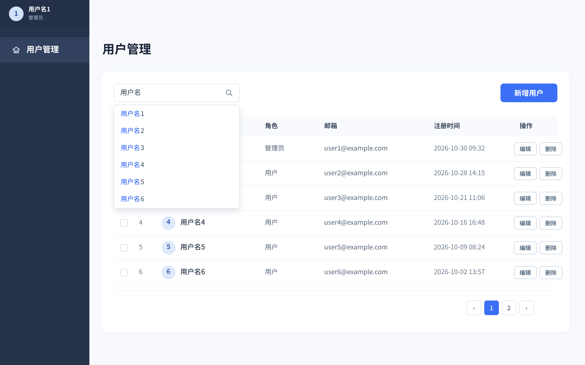
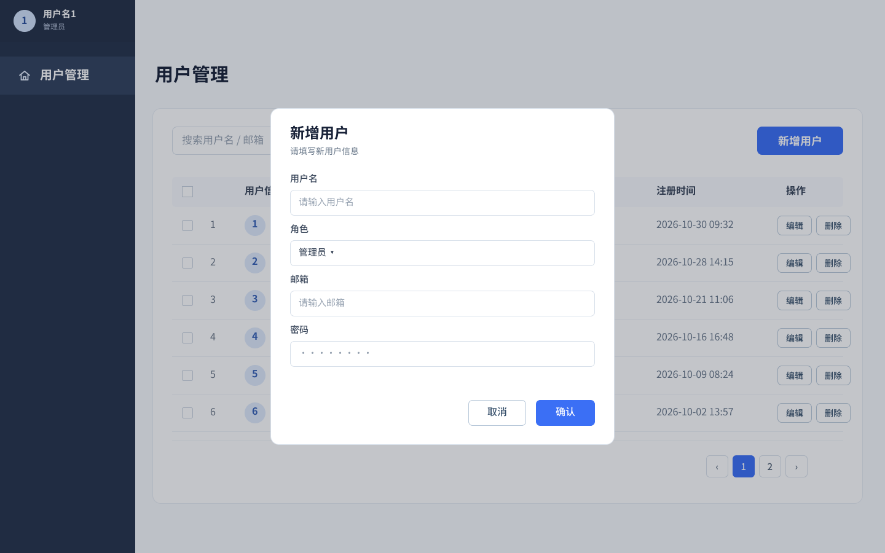
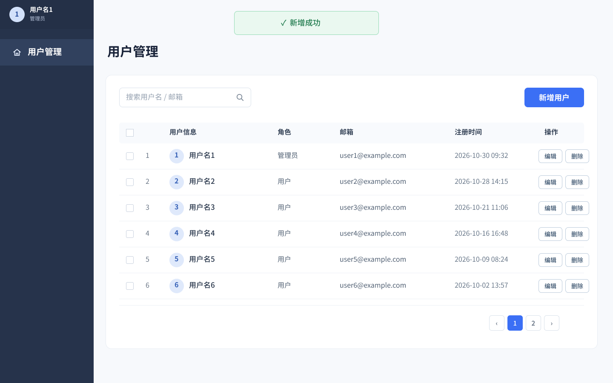
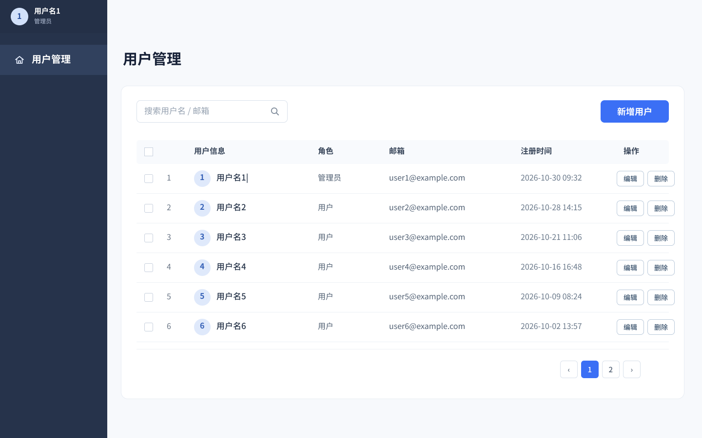
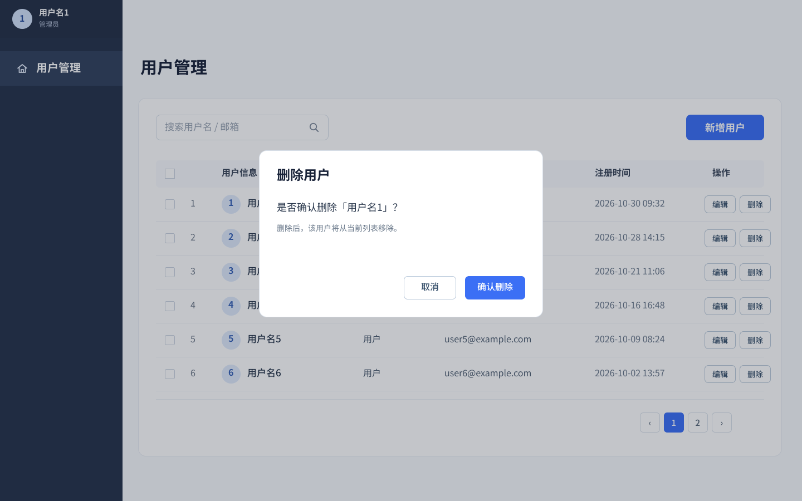
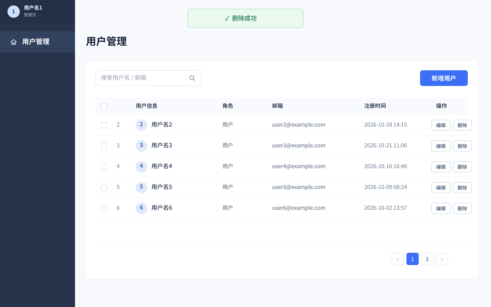
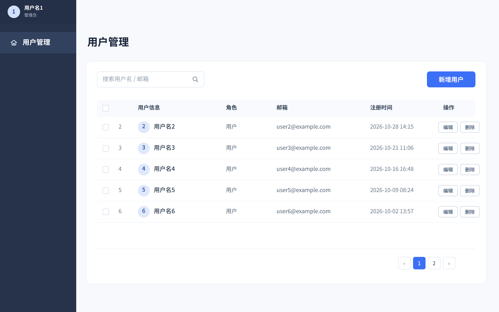

# 后台管理页设计稿

## 1. 范围与实现位置

本稿对应 `check-web/app/admin/page.tsx`，路由为 `/admin`，只描述工作区 `02_后台管理/图片/` 中的 10 张桌面端截图。页面目标是管理用户列表：查看、按用户名或邮箱搜索、新增用户、修改用户名、删除用户。截图为 1440 × 900 px。开发时图片只作为设计参考，不把整页截图放进网页。

页面文件与组件建议如下。业务组件统一放在 `components/admin/`；页面专属样式放在 `app/admin/page.module.css` 与各组件同名 CSS Module 中。`app/globals.css` 不承载后台页面专属样式。

```text
check-web/
├─ app/admin/
│  ├─ page.tsx                     # 路由入口，组合后台页面
│  └─ page.module.css              # 页面底色、侧栏和主内容的整体布局
└─ components/admin/
   ├─ AdminSidebar.tsx             # 管理员信息、用户管理导航
   ├─ AdminSidebar.module.css
   ├─ UserManagement.tsx           # 用户列表区域，协调搜索/弹窗/提示/分页
   ├─ UserManagement.module.css
   ├─ UserSearch.tsx               # 搜索输入、建议列表、搜索图标
   ├─ UserSearch.module.css
   ├─ UserTable.tsx                # 表头、用户行、行内编辑、分页
   ├─ UserTable.module.css
   ├─ UserFormDialog.tsx           # 新增用户表单与角色下拉
   ├─ UserFormDialog.module.css
   ├─ DeleteUserDialog.tsx         # 删除确认弹窗
   ├─ DeleteUserDialog.module.css
   ├─ OperationToast.tsx           # 新增/删除成功提示
   └─ OperationToast.module.css
```

`page.tsx` 渲染 `<main>`，内部左侧为 `AdminSidebar`、右侧为 `UserManagement`。`UserManagement` 管理当前用户列表、搜索词与筛选结果、当前页、新增弹窗、待删除用户和成功提示状态，再把必要数据与回调传给子组件。组件用项目已配置的 `@/components/admin/...` 路径别名导入。需要交互状态的组件标记 `"use client"`；不要把所有交互逻辑和 JSX 都堆在 `page.tsx`。

## 2. 页面基础布局与列表初始状态

左侧深蓝色侧栏宽约 220 px，贯穿视口高度。顶部显示圆形数字头像、管理员用户名“用户名1”和角色“管理员”；下方“用户管理”导航项为当前选中状态。右侧主区域是浅灰底，顶部标题“用户管理”，下方白色圆角内容卡片。卡片顶部左侧为搜索框，右侧为蓝色“新增用户”按钮。表格从左到右为装饰方框、序号、用户信息、角色、邮箱、注册时间、操作。每行用户信息包含圆形数字头像和用户名；操作列有“编辑”“删除”。底部右侧是上一页、页码、下一页。

初始示例图展示 6 行用户和 1、2 两个页码。示例数据用于还原画面，不代表真实数据必须固定为 6 条。表格区域应由用户数据渲染，新增、修改、删除后与当前数据状态保持一致。

**预览 01：用户管理后台初始状态**


### 装饰方框

表头左侧和每行左侧的小方框只用于视觉还原，**没有选择、全选或批量操作功能**。用不可交互元素绘制，避免使用会接受焦点的真实复选框；不给它们绑定点击事件。页面不出现批量删除等截图没有的操作。

## 3. 搜索与建议列表

搜索框提示文案为“搜索用户名 / 邮箱”，右侧有放大镜图标。输入内容时，在输入框下方出现与关键词匹配的用户名建议列表；截图以输入“用户名”为例，显示“用户名1”至“用户名6”。建议浮层覆盖表格上方，不推动表格布局。建议项使用蓝色文字，宽度与搜索框一致。

**筛选触发方式已确认**：点击任一建议项立即完成筛选；输入关键词后点击搜索图标也立即完成筛选。搜索范围包括用户名和邮箱，匹配方式按关键词包含处理。建议项被点击后，输入框填入该项用户名并关闭建议浮层；点击搜索图标后按当前输入值筛选并关闭浮层。清空搜索词恢复完整列表，筛选结果从第一页显示。没有匹配项时给出明确空状态，不继续展示旧结果。

**预览 02：搜索关键词与建议浮层**



## 4. 新增用户流程

点击右上角“新增用户”打开居中的白色圆角弹窗，主区域加半透明灰色遮罩；左侧侧栏仍能看见。弹窗标题“新增用户”，辅助文字“请填写新用户信息”。字段从上到下为：用户名、角色、邮箱、密码。角色默认显示“用户”；密码输入采用遮蔽显示。底部右侧是“取消”和蓝色“确认”。取消关闭弹窗且不新增用户；确认时先校验必填项和邮箱格式，成功后关闭弹窗、更新列表并显示“新增成功”提示。提交期间应避免重复点击造成重复新增。

**预览 03：新增用户表单初始状态**


角色字段点击后，在字段下方打开下拉层，包含“用户”“管理员”两个选项。下拉层覆盖后续字段的位置，不改动弹窗整体高度。点击“管理员”后关闭下拉层，字段显示已选角色；最终提交时采用所选角色。

**预览 09：角色选项展开**


**预览 10：选择管理员角色**



新增成功提示位于主内容区域顶部中央，为浅绿色背景、绿色边框与对勾图标，文字“新增成功”。提示为短暂反馈，不遮挡列表的主要操作；关闭弹窗后列表可继续使用。

**预览 04：新增成功提示**



## 5. 修改用户名

点击某行“编辑”后，仅该行的**用户名**进入行内可编辑状态。截图显示“用户名1”文字后出现输入光标，表格结构、角色、邮箱和注册时间保持原样；不要打开新增用户弹窗来编辑，也不要允许修改其他字段。进入编辑态时聚焦输入框并选中或定位当前用户名。按 **Enter** 或输入框**失焦**均保存新用户名。空白名称不能覆盖原值；保存失败时保留原值并提示失败。保存成功后立即更新表格和搜索建议中的名称。

**预览 05：用户名1行内编辑**



## 6. 删除用户流程

点击某行“删除”弹出确认框。弹窗居中，遮罩覆盖主区域，标题“删除用户”，正文明确显示待删除用户名，例如“是否确认删除「用户名1」？”，辅助文案“删除后，该用户将从当前列表移除。”按钮为“取消”和蓝色“确认删除”。取消关闭弹窗，列表不变；确认后删除对应用户，不得误删其他行。提交期间避免重复删除。

**预览 06：删除用户确认弹窗**



成功后关闭弹窗，列表立即移除该用户，页面顶部显示与新增成功同样样式的浅绿色提示，文字“删除成功”。截图 07 是提示出现时的五行列表，截图 08 是提示消失后的稳定状态。删除后保留其他行的原序号和圆形头像数字；不要因为少了一行就把用户 2–6 改成 1–5。当前页若因删除而变空，应切到仍有数据的上一页。

**预览 07：删除成功提示及列表更新**



**预览 08：提示消失后的五行列表**



## 7. 分页与状态协调

截图显示底部右侧的上一页、页码 1、页码 2、下一页。当前页用蓝底白字区分。点击页码或方向按钮切换当前列表页，边界页的方向按钮不可继续前进。搜索后重置到第一页；新增和删除后根据结果总量更新分页。每页容量按截图中的 6 行作为桌面初始参考，实际页数由数据总量计算，不写死“只有两页”。

搜索浮层、表单弹窗和删除确认框不要同时开放。弹窗打开后焦点进入弹窗；取消或完成后焦点回到触发按钮。成功提示可使用 `role="status"`，错误提示应让用户能读到。页面的主要交互元素支持键盘操作。

## 8. 样式与交付检查

- `app/admin/page.module.css`：左右两栏、页面背景和主区域外边距；侧栏约 220 px。
- `AdminSidebar.module.css`：深蓝底、管理员信息、选中导航项。
- `UserManagement.module.css`：页面标题、白色卡片和工具栏布局。
- `UserSearch.module.css`：约 310 px 宽的搜索框、建议浮层及层级。
- `UserTable.module.css`：表头、约 60 px 高的行、分隔线、用户头像、操作按钮和分页。
- 两个 Dialog 的样式文件分别控制遮罩、弹窗尺寸、字段及按钮；`OperationToast.module.css` 统一成功提示外观。
- 在 1440 × 900 px 桌面视口下，按十张预览图逐一核对初始列表、搜索建议、新增表单、角色展开与选中、新增成功、行内编辑、删除确认、删除成功及删除完成状态。
- 检查“搜索建议点击”和“搜索图标点击”都筛选；Enter 和失焦都保存用户名；装饰方框不能获得焦点或触发操作。

截图没有给出后端接口地址、字段协议和数据持久化方式。本稿规定页面行为和状态变化；开发对接实际用户数据接口时，保持这里的视觉与交互结果，不把示例用户名和邮箱写死为正式数据。
