# 查重提交页设计稿

## 1. 范围与文件安排

本稿对应 `check-web/app/check/page.tsx`，路由 `/check`。以 `03_查重提交/图片/` 的 15 张 **1440 × 810 px 桌面截图**为视觉依据，页面背景使用现成资源：[file (3).webp](../资源/file%20(3).webp)。页面负责选一本对标书籍、切换网文输入方式，以及展示提交入口。当前版本不实现查重处理和报告结果。

业务组件统一放在 `check-web/components/check/`，页面级布局放在 `app/check/page.module.css`，各组件的样式放同目录 CSS Module；不要把所有 JSX 与状态堆在 `page.tsx`。

```text
check-web/
├─ app/check/
│  ├─ page.tsx                       # 页面入口、整体布局
│  └─ page.module.css                # 引用背景图片、主卡片、间距
├─ public/check/
│  └─ background.webp                # 从 03_查重提交/资源/file (3).webp 复制
└─ components/check/
   ├─ CheckHeader.tsx                # 未登录/已登录页头
   ├─ CheckHeader.module.css
   ├─ CheckForm.tsx                  # 协调书籍选择、输入方式、提交提示
   ├─ CheckForm.module.css
   ├─ BookSelector.tsx               # 三个分类、各分类下拉、已选书名
   ├─ BookSelector.module.css
   ├─ BookSearch.tsx                 # 书名/作者搜索框、建议列表
   ├─ BookSearch.module.css
   ├─ ManuscriptInput.tsx            # 上传文档/粘贴文本切换
   ├─ ManuscriptInput.module.css
   ├─ SubmitNotice.tsx               # “请先登录”提示
   └─ SubmitNotice.module.css
```

`page.tsx` 输出 `<main>`，上方渲染 `CheckHeader`，浅蓝背景中渲染白色主卡片与 `CheckForm`。`CheckForm` 持有唯一的 `selectedBook`、当前分类/下拉状态、搜索词、输入方式和提示状态，并将数据与回调传给子组件。需要交互状态的组件标记 `"use client"`。组件使用项目现有 `@/components/check/...` 别名导入。

## 2. 初始页面布局

页面顶端是约 40 px 高的白色细页头，未登录时右侧显示“登录”“注册”。页头下方使用提供的背景图片，里面是一张居中的白色圆角主卡片：桌面参考图中左右边距约 45 px、顶部约 50 px、底部约 700 px。卡片内部上半段为“对标书籍”区，下半段为“上传网文”区，两区之间用浅色水平线分隔。底部是通栏蓝色“提交”按钮。

对标书籍区第一行左侧是“对标书籍”标签及三个浅灰分类按钮：“起点中文网”“番茄小说网”“其它”。第二行是带放大镜图标的长搜索框与右侧蓝色“搜索”按钮。上传网文区有“上传文档”“粘贴文本”单选式切换，初始选中“上传文档”；中央是虚线边框与蓝色加号组成的上传占位区，下方文字“上传文档”。整体保持截图中的大面积留白。

**预览 01：初始状态**


## 3. 登录状态与提交行为

未登录时，页头右侧保持“登录”“注册”入口。用户点击底部“提交”，只在主卡片顶部附近显示红色浅底提示“请先登录”，不跳转、不清空已选内容，也不启动查重。提示应是短暂反馈，随后恢复原页面。

**预览 02：未登录点击提交**

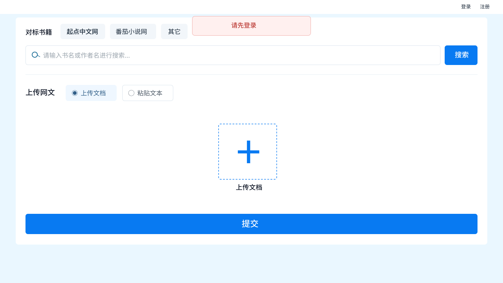

已登录时，页头右侧改为圆形数字头像与用户名，截图示例为“1 用户名1”。点击底部“提交”按钮可以按下，但**当前版本不产生后续效果**：不跳转、不展示成功/失败提示、不生成报告，也不调用尚未确定的查重流程。请在提交处理代码旁写 `TODO` 注释，说明后续需接入实际提交与报告流程。不要为了演示而伪造提交成功。

**预览 03：已登录页头**

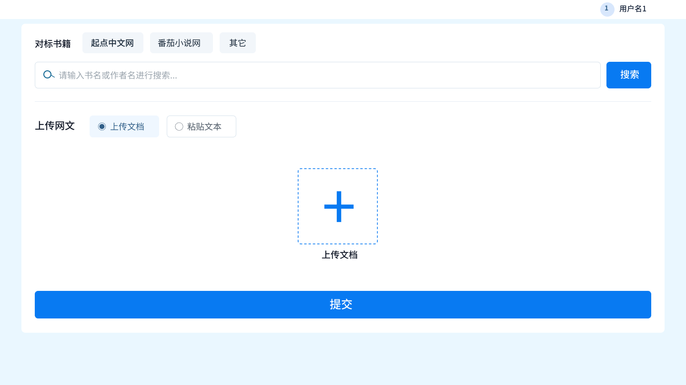

## 4. 分类下拉与单本书选择

点击“起点中文网”时，分类按钮变蓝，按钮下方展开选项“诡秘之主”“道诡异仙”。下拉浮层覆盖搜索框上方，不推动其余内容。点击“番茄小说网”时显示“十日终焉”“我在精神病院学斩神”；点击“其它”时显示“龙族”。同时只打开一个分类下拉。分类按钮的蓝色表示**当前展开的分类**，不是已经完成选书。

**预览 04：起点中文网下拉**

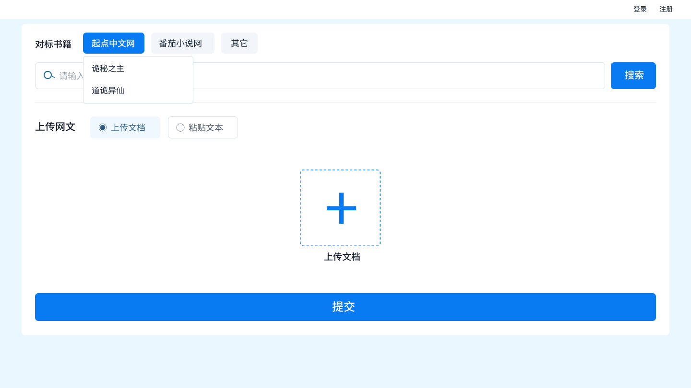

**预览 05：番茄小说网下拉**

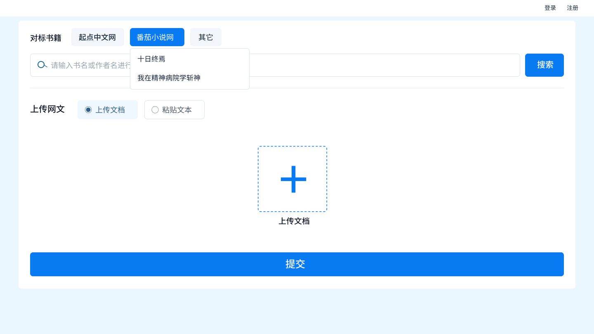

**预览 06：其它下拉**

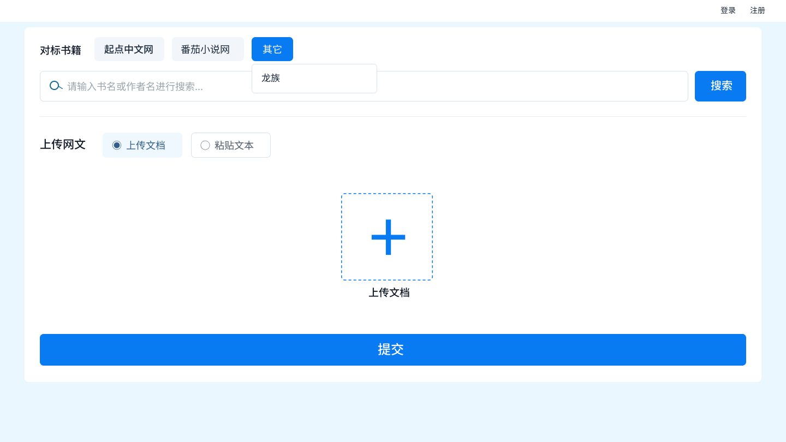

每次**只允许选择一本**对标书。以下五张图显示下拉选项获得蓝色高亮的状态，分别对应五本书。选中某一项后，关闭下拉，并把顶部三个分类按钮整体移除；原位置显示所选书籍的**具体书名**。这就是选中后的最终显示方式，不保留三个分类按钮，也不显示多选标签。

**预览 07：诡秘之主高亮**

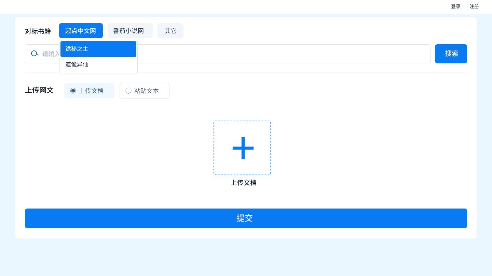

**预览 08：道诡异仙高亮**

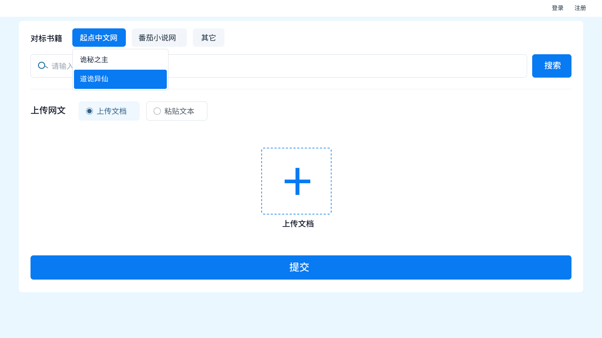

**预览 09：十日终焉高亮**

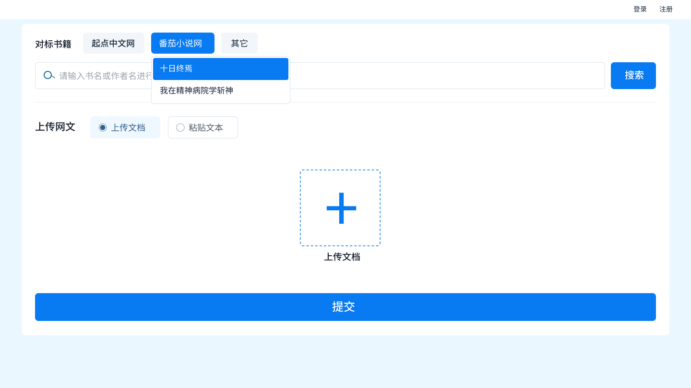

**预览 10：我在精神病院学斩神高亮**

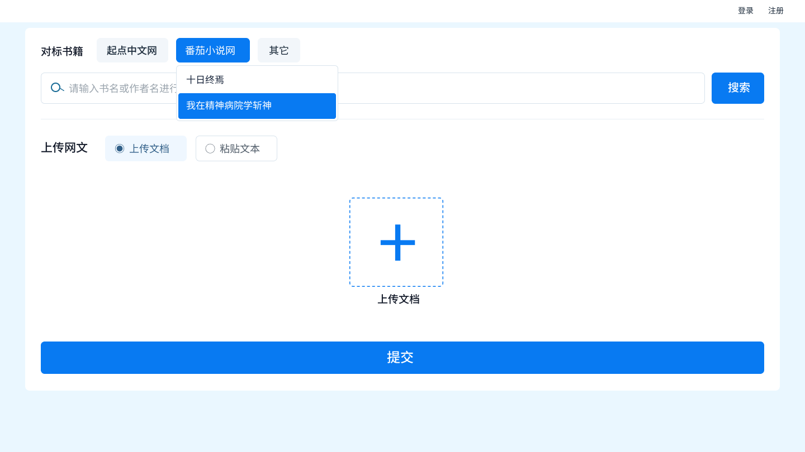

**预览 11：龙族高亮**

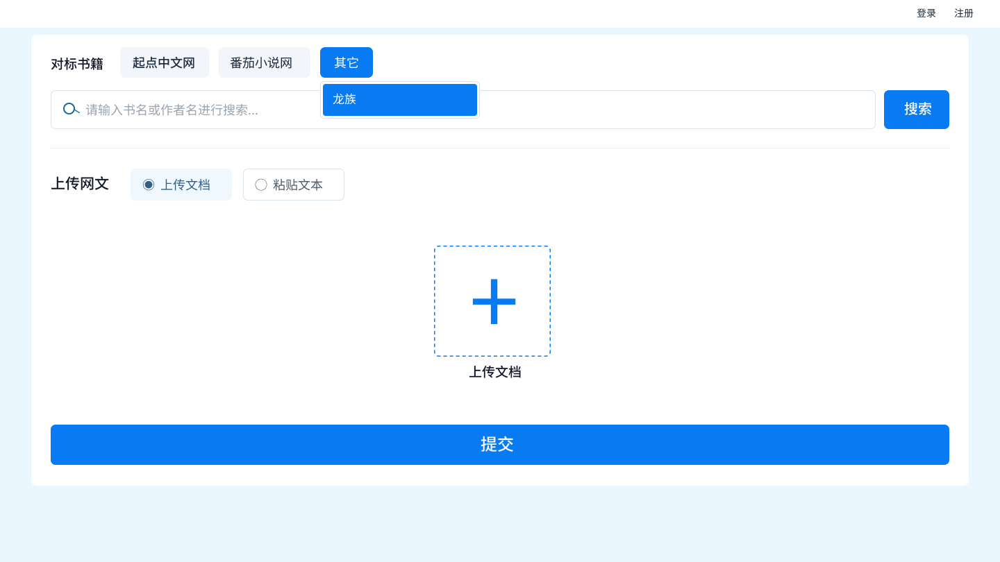

图 07–11 中下拉层仍打开，表示选项被指向或按下的瞬时状态；**图 14 才是选择完成后的稳定状态**。如需重新选书，用户可重新使用搜索框搜索并选中另一项；新选择替换原书，不形成多选。

## 5. 搜索书籍

搜索框提示文案“请输入书名或作者名进行搜索...”。聚焦时光标出现在输入区域。输入关键词后，在搜索框下方展示匹配建议，匹配文字可用蓝色突出；建议浮层覆盖下方内容，不推开“上传网文”区。图 13 输入“诡”，建议出现“诡秘之主”。点击建议项选中该书，并清空输入框；分类按钮被书名替换，如图 14。点击右侧“搜索”按钮按当前关键词展示匹配结果，最终仍须由用户选择具体书籍，不能只输入文字就默认选中一本。

**预览 12：搜索框获得焦点**

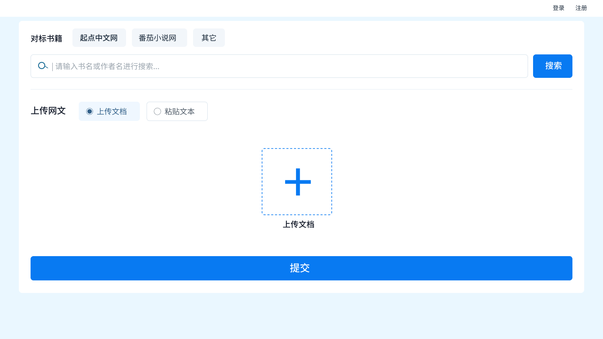

**预览 13：输入关键词诡**

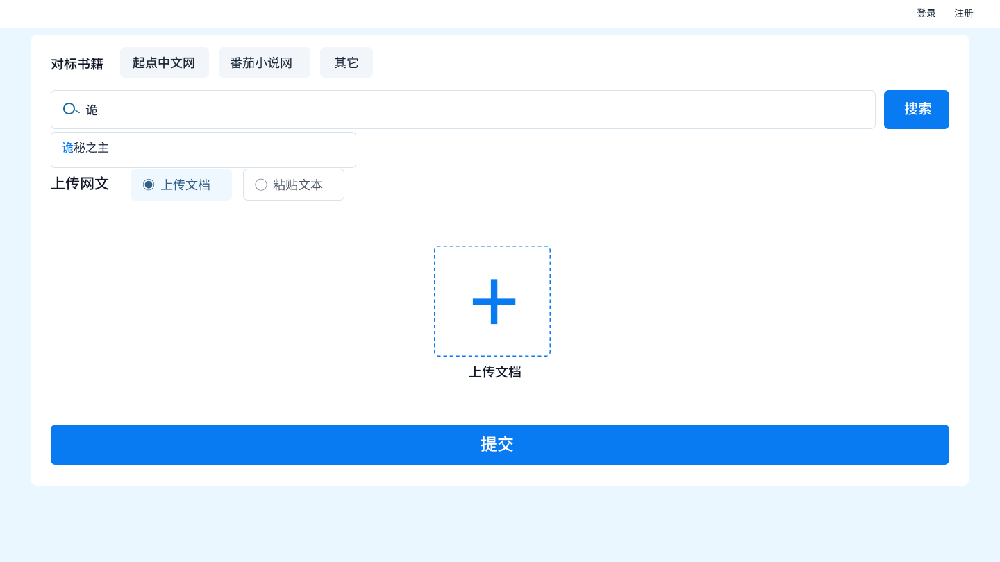

**预览 14：搜索并选中诡秘之主后的稳定状态**

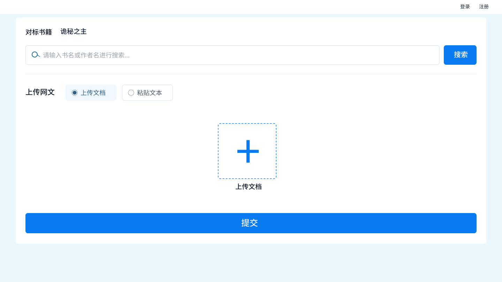

书籍选项目前只需覆盖截图中的五本示例。后续接入真实书库时，可替换数据来源，但保持分类、搜索和单选后的显示规则。

## 6. 网文输入方式

“上传文档”和“粘贴文本”为互斥选项，默认“上传文档”。选中态采用浅蓝背景与实心单选圆点，非选中态为白底描边与空心圆点。

- **上传文档**：显示虚线方框、蓝色加号和“上传文档”文字。当前提供的设计只要求**界面占位**；文件格式、大小限制与实际上传流程均待定。不要在设计稿中虚构允许的文件类型或上传成功状态。代码旁留注释标明后续接入上传能力。
- **粘贴文本**：切换后，用大面积带细边框的多行文本框替换上传占位区，输入光标从左上角开始。两种方式切换时保持卡片和底部提交按钮的位置基本稳定。

**预览 15：切换到粘贴文本**

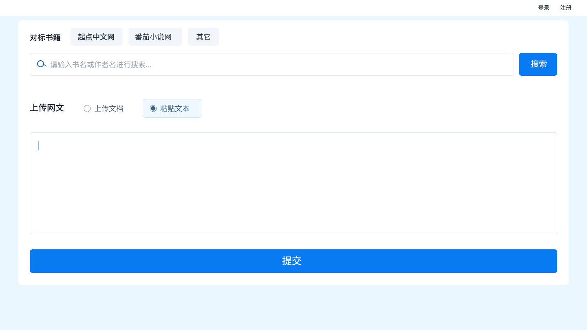

## 7. 样式归属与验收

- `app/check/page.module.css`：顶部页头与主卡片的整体摆放，以及背景图片引用。开发时将 `03_查重提交/资源/file (3).webp` 复制为项目的 `public/check/background.webp`，在页头下方的页面容器上设置 `background-image: url('/check/background.webp')`、`background-size: cover`、`background-position: center`。直接使用资源图片，不用 CSS 绘制替代背景。
- `CheckHeader.module.css`：页头高度、右侧登录/注册或头像/用户名。
- `CheckForm.module.css`：卡片内两大区域、分隔线和通栏提交按钮。
- `BookSelector.module.css`：分类按钮、蓝色展开态、下拉浮层、选项高亮、选定后的书名位置。
- `BookSearch.module.css`：输入框、搜索图标、搜索按钮、建议浮层及匹配文字。
- `ManuscriptInput.module.css`：互斥切换控件、上传占位框、多行文本框。
- `SubmitNotice.module.css`：未登录提交时的红色提示。

交付时按 01–15 每张预览图核对对应状态；重点核对单本书选择后移除三个分类按钮、搜索选中后的稳定页面、未登录提交只提示、已登录提交暂不产生结果，以及上传区域仅为占位。页面交互元素支持键盘聚焦；浮层打开时应位于输入框和内容之上，不遮挡底部提交按钮。
