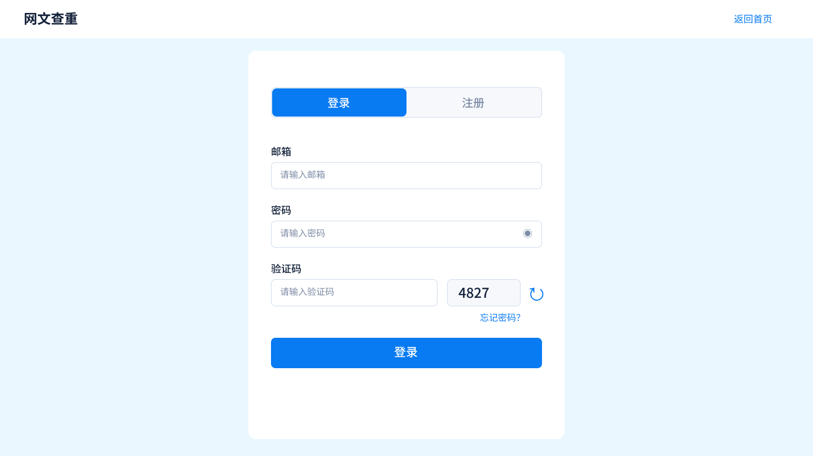
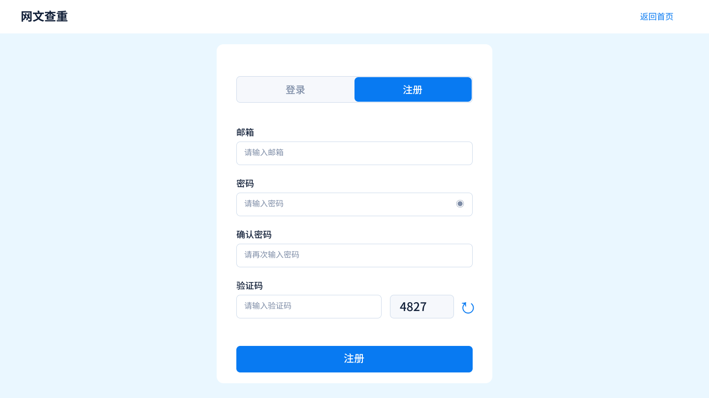

# 登录注册页设计稿

## 1. 范围与实现位置

本稿对应 `check-web/app/login/page.tsx`，路由 `/login`。以 [登录页](../图片/01_登录页.png)、[注册页](../图片/02_注册页.png) 两张 **1440 × 810 px** 桌面截图为视觉参考。两种表单在同一页面卡片内通过顶部标签切换，不另建注册路由。页面背景直接使用 [资源背景](../资源/file%20(3).webp)。

业务组件统一放在 `check-web/components/auth/`，页面级布局与背景放在 `app/login/page.module.css`，组件各自使用同目录 CSS Module。

```text
check-web/
├─ app/login/
│  ├─ page.tsx                       # 路由入口，组合页头与认证卡片
│  └─ page.module.css                # 页面布局与背景图片引用
├─ components/auth/
│  ├─ AuthHeader.tsx                 # 品牌标题、返回首页
│  ├─ AuthHeader.module.css
│  ├─ AuthPanel.tsx                  # 登录/注册标签与视图切换
│  ├─ AuthPanel.module.css
│  ├─ LoginForm.tsx                  # 登录字段与提交
│  ├─ LoginForm.module.css
│  ├─ RegisterForm.tsx               # 注册字段与提交
│  ├─ RegisterForm.module.css
│  ├─ CaptchaPlaceholder.tsx         # 验证码视觉占位
│  └─ CaptchaPlaceholder.module.css
└─ public/auth/
   └─ background.webp                # 从 04_登录注册/资源/file (3).webp 复制
```

`page.tsx` 负责 `<main>` 和组件组合；`AuthPanel` 负责当前标签状态，初始为“登录”。`LoginForm` 与 `RegisterForm` 各管自己的字段、校验与提交。需要输入状态的组件标记 `"use client"`。组件使用项目的 `@/components/auth/...` 别名导入。验证码占位组件由两种表单共用，避免两处界面不一致。

## 2. 共用页面布局

顶部是一条约 68 px 高的白色页头，左侧深色粗体“网文查重”，右侧蓝色“返回首页”，点击返回 `/`。页头以下使用提供的背景资源，开发时复制为 `public/auth/background.webp`，由 `app/login/page.module.css` 设置 `background-image: url('/auth/background.webp')`、`background-size: cover`、`background-position: center`。不要用 CSS 颜色或渐变重新绘制背景。

认证卡片为白色圆角矩形，桌面参考图中宽约 560 px，水平居中，顶部约 y=90 px，底部约 y=780 px。内部左右留约 40 px 边距。最上方是“登录 / 注册”双标签切换，宽度与表单输入框一致，选中项蓝底白字，未选中项浅灰底灰字。字段标题、输入框、验证码行和底部主按钮沿同一左边缘对齐。切换标签时保持同一卡片位置和宽度，不打开新弹窗。

## 3. 登录视图

登录表单从上到下包含：

1. **邮箱**：标题“邮箱”，输入提示“请输入邮箱”。
2. **密码**：标题“密码”，输入提示“请输入密码”，输入内容遮蔽。右侧图标按密码可见性切换处理，不改变输入框尺寸。
3. **验证码**：标题“验证码”，左侧输入提示“请输入验证码”，右侧为四位数字样式占位框与刷新图标。下方靠右显示蓝色“忘记密码?”。
4. **主按钮**：蓝底白字，文案“登录”，与输入区同宽。

登录时校验邮箱格式，并要求邮箱和密码非空；验证码**暂不参与真实校验**。登录成功后跳转 `/check`。认证失败时保留当前输入内容并给出可读的失败提示，不伪装成成功。表单提交过程中避免重复触发。成功与失败由项目实际认证逻辑决定，设计稿不规定后端接口协议。

“忘记密码?”目前只作展示，点击**没有交互效果**，不跳转、不弹窗。开发人员在该元素旁写 `TODO` 注释，说明后续接入找回密码流程；当前用不可交互元素呈现，避免误导键盘用户。

**预览 01：登录视图**



## 4. 注册视图

点击顶部“注册”标签后，在同一卡片内切换到注册表单。注册表单从上到下包含：

1. **邮箱**：标题“邮箱”，输入提示“请输入邮箱”。
2. **密码**：标题“密码”，输入提示“请输入密码”，内容遮蔽，右侧可见性图标与登录表单一致。
3. **确认密码**：标题“确认密码”，输入提示“请再次输入密码”，内容遮蔽；提交前必须与密码一致。
4. **验证码**：同登录视图的输入框、四位数字样式占位框与刷新图标。
5. **主按钮**：蓝底白字，文案“注册”。注册视图没有“忘记密码?”。

注册时校验邮箱格式，要求邮箱、密码和确认密码非空且两次密码一致；验证码暂不参与真实校验。注册成功后**切换到登录视图**，让用户登录。注册失败时保留输入内容并给出错误提示，不直接跳到查重页。提交期间避免重复注册。

**预览 02：注册视图**



## 5. 验证码占位与待接入功能

两张截图中验证码框展示四位数字“4827”，旁边有刷新图标。当前版本只需还原这个**视觉占位**，不生成有效验证码、不向服务端校验，也不因验证码内容阻止登录或注册。刷新图标目前无需产生真实验证码；代码中 `CaptchaPlaceholder.tsx` 旁明确写 `TODO: 后续接入验证码验证库，替换占位数字、刷新动作和提交校验。` 不要把固定数字“4827”当作正式安全校验机制。

“忘记密码”功能也待后续实现；不要先做虚假的找回密码页或成功提示。验证码库及找回密码接口确定后，再扩展对应组件。

## 6. 样式归属与验收

- `app/login/page.module.css`：页头以下的全视口背景图、卡片整体居中与高度。
- `AuthHeader.module.css`：白色页头、左右文字位置与“返回首页”链接。
- `AuthPanel.module.css`：白色卡片、双标签的尺寸和选中态。
- `LoginForm.module.css`、`RegisterForm.module.css`：各自的字段排布、输入框、主按钮和提示信息；相同控件的视觉保持一致。
- `CaptchaPlaceholder.module.css`：验证码行的输入框、四位数字框和刷新图标。
- 在 1440 × 810 px 桌面视口下分别对照两张预览图；切换标签时卡片不横向跳动。
- 验证“返回首页”进入 `/`；注册成功回到登录视图；登录成功进入 `/check`；验证码与“忘记密码”只保留占位及代码注释。
