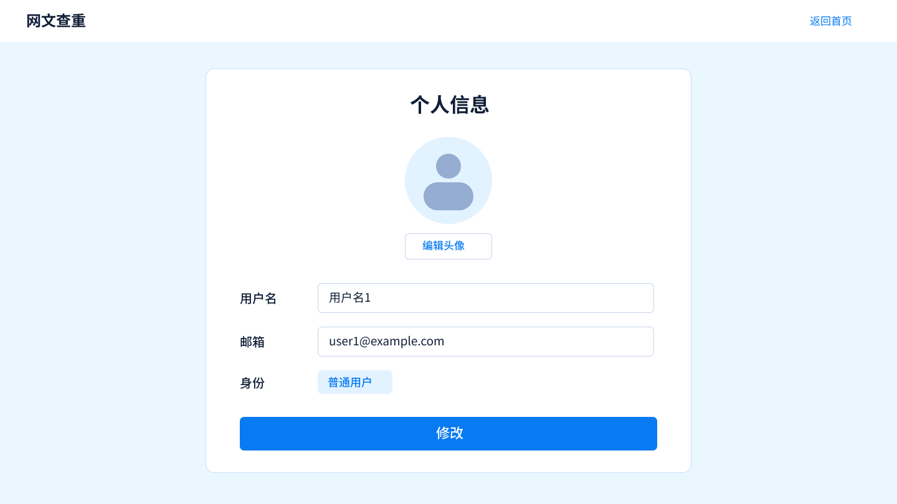

# 个人信息页设计稿

## 1. 范围与实现位置

本稿对应 `check-web/app/user/page.tsx`，路由 `/user`。以 [初始状态](../图片/01_个人信息_初始状态.png) 与 [修改状态](../图片/02_个人信息_修改状态.png) 两张 **1440 × 810 px** 桌面截图为依据。页面展示当前用户信息，并允许修改**用户名**。邮箱和身份只读；头像编辑当前仅作占位。背景直接使用 [资源图片](../资源/file%20(3).webp)。

个人信息页业务组件统一放在 `check-web/components/user/`。页面级布局与背景放在 `app/user/page.module.css`，组件专属视觉放在同目录 CSS Module。

```text
check-web/
├─ app/user/
│  ├─ page.tsx                    # 路由入口，组合页头和个人信息卡片
│  └─ page.module.css             # 页头以下的背景图、卡片居中
├─ components/user/
│  ├─ UserPageHeader.tsx          # 品牌文字、返回首页
│  ├─ UserPageHeader.module.css
│  ├─ ProfileCard.tsx             # 用户信息卡片及编辑状态协调
│  ├─ ProfileCard.module.css
│  ├─ ProfileAvatar.tsx           # 默认头像与编辑头像占位入口
│  ├─ ProfileAvatar.module.css
│  ├─ ProfileFields.tsx           # 用户名、邮箱、身份三行
│  └─ ProfileFields.module.css
└─ public/user/
   └─ background.webp             # 从 05_个人信息/资源/file (3).webp 复制
```

`page.tsx` 输出 `<main>`，渲染 `UserPageHeader` 与 `ProfileCard`。`ProfileCard` 持有当前用户资料、用户名草稿和是否处于编辑状态，并向 `ProfileAvatar`、`ProfileFields` 传入所需数据与回调。交互组件标记 `"use client"`。导入使用项目已配置的 `@/components/user/...` 别名。页面文件保持简短，用户信息展示和编辑逻辑放在组件中。

## 2. 共用页面布局

顶部为约 68 px 高的白色页头，左侧深色粗体“网文查重”，右侧蓝色“返回首页”，点击进入 `/`。页头下方使用提供的背景图。开发时将 `05_个人信息/资源/file (3).webp` 复制到项目 `public/user/background.webp`，在 `app/user/page.module.css` 中以 `background-image: url('/user/background.webp')` 引用，并设置 `background-size: cover`、`background-position: center`。不要用纯色或 CSS 渐变代替资源图。

个人信息卡片为居中的白色圆角矩形，浅蓝细边框。参考截图中，卡片约从 x=330 到 x=1110、y=110 到 y=760；内部宽约 670 px。顶部标题“个人信息”居中。标题下方是圆形默认头像及“编辑头像”按钮。再往下依次是用户名、邮箱、身份三行，左侧标签对齐，右侧内容对齐；底部是与内容区同宽的蓝色主按钮。页面只保留截图中的模块，不添加额外导航或统计信息。

## 3. 初始展示状态

- 标题“个人信息”居中。
- 默认头像为浅蓝圆形背景，内部是蓝灰色人物轮廓。若当前用户还没有头像，就显示该默认图形。
- 头像下方是描边按钮“编辑头像”。**当前仅作视觉占位**，点击不打开文件选择器、不上传文件，也不改变头像。在 `ProfileAvatar.tsx` 的按钮旁写 `TODO: 后续接入头像选择、上传、预览与保存。` 当前建议用不可交互元素还原按钮外观，避免暗示功能已可用。
- “用户名”显示当前用户名，截图示例“用户名1”；“邮箱”显示当前邮箱，截图示例 `user1@example.com`；“身份”显示浅蓝标签“普通用户”。这些值来自当前用户资料，截图文案仅作为示例，不写死为正式数据。
- 底部主按钮文案“修改”。点击后进入用户名修改状态。

**预览 01：个人信息初始状态**



## 4. 修改用户名状态与保存

点击“修改”后，用户名一行进入编辑状态，输入框获得焦点，光标位于现有用户名末尾；底部主按钮文案改为“保存修改”。布局、头像、邮箱、身份及背景均保持不变。**只能修改用户名**：邮箱虽然有输入框外观，但始终只读，不能输入；身份标签也不能切换。不要把邮箱或身份纳入保存数据。

点击“保存修改”时，先检查用户名不是空白内容；有效时保存当前草稿，更新展示值，并返回初始状态，主按钮恢复“修改”。保存失败时保持修改状态和输入值，给出可读的错误提示，避免看起来已保存但数据未更新。用户名显示应与页面其他已登录位置保持一致。具体保存接口由项目用户资料逻辑提供，本稿不虚构接口地址。

**预览 02：用户名修改状态**


## 5. 样式归属与验收

- `app/user/page.module.css`：白色页头以下的背景资源引用、卡片的桌面居中位置与页面高度。
- `UserPageHeader.module.css`：品牌文字和返回链接的位置、颜色、字号。
- `ProfileCard.module.css`：白色卡片、标题、整体纵向间距、底部蓝色主按钮。
- `ProfileAvatar.module.css`：默认圆形头像、人物图形、编辑头像占位按钮。
- `ProfileFields.module.css`：三行标签、用户名输入框、只读邮箱框和身份标签的对齐与状态。
- 在 1440 × 810 px 桌面视口下，对照两张预览图检查布局和按钮文案。点击“修改”后只给用户名输入焦点；点击“保存修改”后更新用户名并恢复初始状态。
- “编辑头像”当前无上传行为，代码保留后续扩展注释；邮箱和身份不可修改；“返回首页”进入 `/`。
